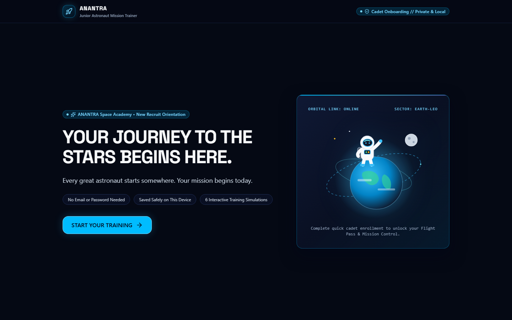
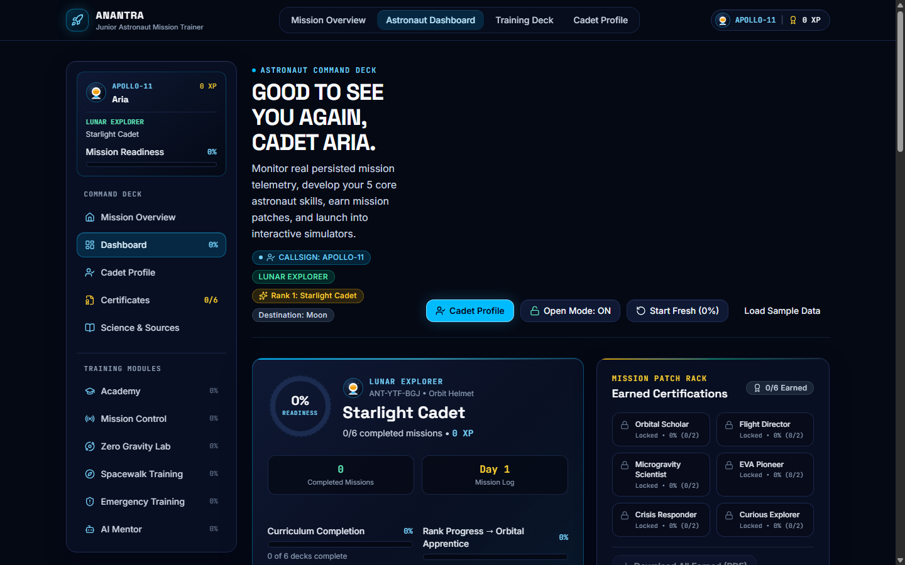
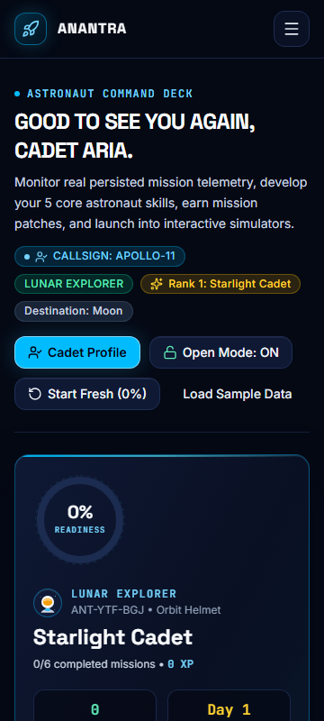
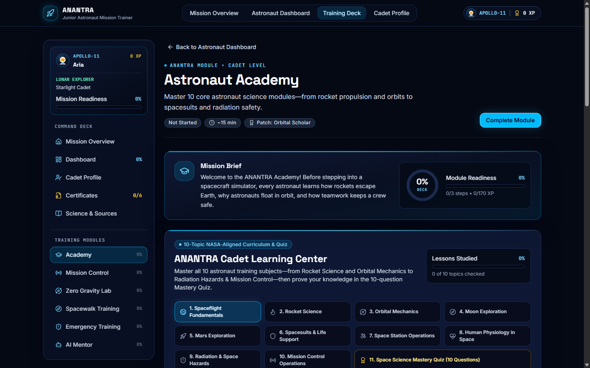
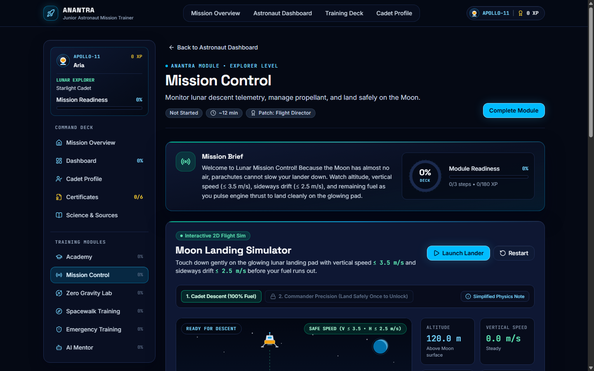
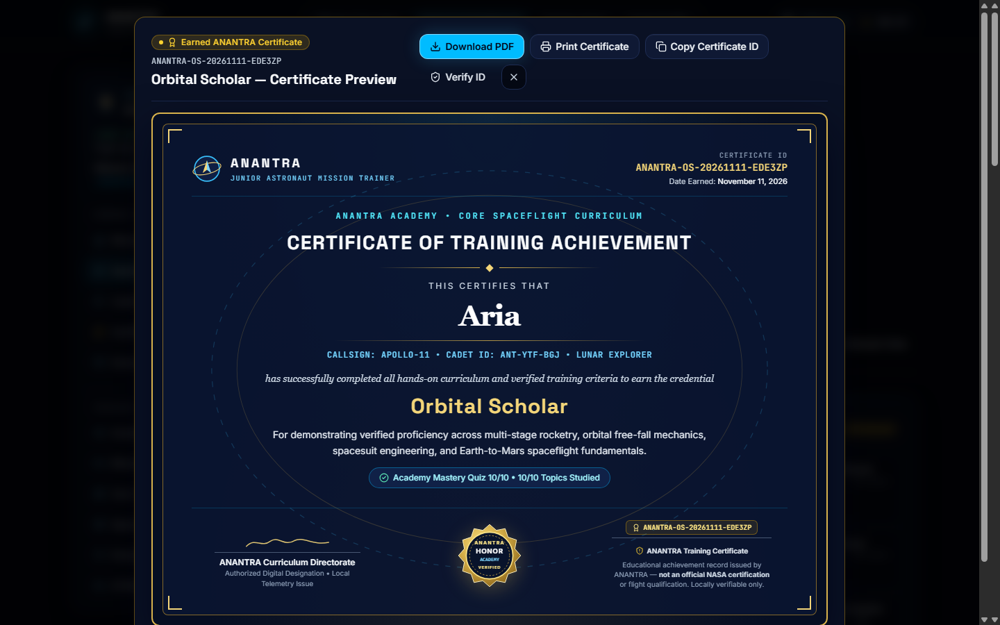
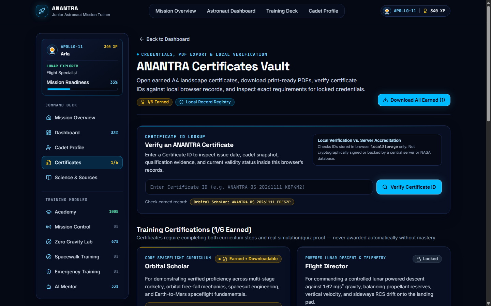
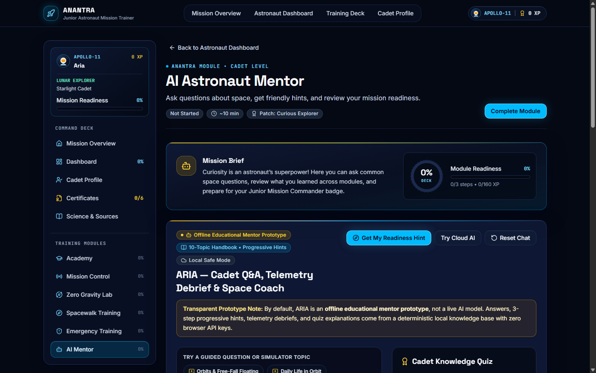

# ANANTRA — Junior Astronaut Mission Trainer

[](https://react.dev/)
[](https://www.typescriptlang.org/)
[](https://vite.dev/)
[](https://tailwindcss.com/)
[](https://vitest.dev/)
[](SECURITY.md)

> **"Train Like a Junior Astronaut. Launch Into Orbit."**

**ANANTRA** (*Junior Astronaut Mission Trainer*) is an interactive, scientifically grounded spaceflight learning platform built for the **NASA Space Apps Challenge**. Designed for young learners, classrooms, families, and STEM judges, ANANTRA combines a personalized Cadet Enrollment Academy, 10 curriculum lessons with vector diagrams, 4 interactive physics and crisis simulators, a landscape A4 **Certificate Generation & Verification System**, a curated NASA bibliography page, and a hybrid offline-capable Astronaut Mentor (**ARIA**) — with zero accounts, zero tracking, and zero required API keys.

**Live Site:** [https://anantra-nasa.vercel.app](https://anantra-nasa.vercel.app/)  
**Repository:** [https://github.com/angad-r/Anantra](https://github.com/angad-r/Anantra)

---

## Table of Contents

1. [Project Overview](#project-overview)
2. [Key Features](#key-features)
3. [Training Modules & Curriculum](#training-modules--curriculum)
4. [Certificate Generation & PDF System](#certificate-generation--pdf-system)
5. [Technology Stack](#technology-stack)
6. [Application Architecture](#application-architecture)
7. [Screenshots](#screenshots)
8. [Installation & Local Development](#installation--local-development)
9. [Environment Variables (Optional Cloud AI)](#environment-variables-optional-cloud-ai)
10. [Project Folder Structure](#project-folder-structure)
11. [Testing & Verification](#testing--verification)
12. [Deployment Instructions](#deployment-instructions)
13. [Scientific References & NASA Educational Resources](#scientific-references--nasa-educational-resources)
14. [Credits & Project Status](#credits--project-status)

---

## Project Overview

Spaceflight science often feels abstract when presented through static slides or passive articles. **ANANTRA** puts cadets in the commander's seat across real cause-and-effect engineering trade-offs:

- First-time visitors open a **Cadet Enrollment Academy** (*"Your Journey to the Stars Begins Here"*), picking a non-identifying First Name, Callsign, optional age group, custom SVG avatar crest, optional target destination, and one of four **Astronaut Specializations**.
- Cadets then unlock the **Command Deck**, tracking live readiness percentages, **1,100 XP** across **18 deck objectives**, simulator high scores (`moduleRecords`), activity telemetry (`activityHistory`), **5 Astronaut Ranks**, and **6 mastery-gated Certificates**.
- Every simulation and lesson stays honest about its classroom approximations via dedicated engineering notes and a searchable **Science, Models & NASA References** page (`/references`).

---

## Key Features

- **Personalized Zero-PII Cadet Onboarding:** Multi-step badge registration validating non-identifying callsigns (actively blocking accidental `@` email entries), paired with 6 bespoke SVG crests and 4 specializations (*Lunar Explorer*, *Mars Pioneer*, *Space Station Specialist*, *Cosmic Scientist*).
- **Responsive Astronaut Command Deck (`/dashboard`):** Live `OrbitalRing` readiness meter, rank progression, recent telemetry log, interactive Certificate cards, search & status filters (`All`, `In Progress`, `Not Started`, `Completed`), and verified zero-overflow responsiveness across `360px` mobile through `1920px` desktop.
- **10-Topic NASA-Grounded Academy (`/academy`):** Structured curriculum spanning orbital mechanics, staging rocketry, Moon/Mars exploration, EVA suits, ISS operations, human physiology, radiation hazards, NASA mission case studies, interactive SVG diagrams, and a 10-question Mastery Exam.
- **Four Real-Time Physics & Triage Simulators:** Moon Landing telemetry pilot (`1.62 m/s²` lunar gravity + unlockable Commander precision mode), 1D Zero-Gravity Inertia Chamber (`a = F / m` + water droplet surface tension comparison), Spacewalk EVA Safety Locker & `100% O₂` truss repair, and 3-Alert Emergency Triage Drill.
- **Real Landscape A4 Certificate System (`/certificates` & `/certificates/verify`):** Mastery-gated credentials with interactive modal previews, native vector A4 landscape PDF generation (`jsPDF`), clean `@media print` sheet isolation, Copy ID, deliberate Reissue tracking, and transparent browser-local ID lookup.
- **Hybrid Astronaut Mentor (`ARIA` at `/ai-mentor`):** Instant deterministic local knowledge base, 3-step progressive simulator hints, and live telemetry debriefs offline — plus optional serverless `/api/mentor` Gemini/OpenAI enhancement when deployed with server-side environment keys.
- **Science & Model Transparency (`/references`):** 18 live-verified NASA educational references paired with explicit tables separating established spaceflight science from simplified classroom browser physics.

---

## Training Modules & Curriculum

ANANTRA includes **6 core training decks** totaling **18 objectives** and **1,100 XP**:

| # | Module & Route | Difficulty | Certificate Unlocked | Max XP | Interactive Experience |
| :---: | :--- | :--- | :--- | :---: | :--- |
| **1** | **Astronaut Academy** (`/academy`) | Cadet | *Orbital Scholar* | `170` | 10 spaceflight curriculum topics, vector diagrams, NASA case studies, misconception prompts & 10-question exam (`>= 7/10` mastery) |
| **2** | **Mission Control** (`/mission-control`) | Explorer | *Flight Director* | `180` | 2D lunar powered descent under `1.62 m/s²` gravity, hover presets, RCS steering, Cadet & unlockable Commander difficulties, 4-metric landing score |
| **3** | **Zero Gravity Lab** (`/zero-gravity-lab`) | Explorer | *Microgravity Scientist* | `180` | 1D `a = F / m` inertia track comparing zero drag vs. Earth friction, astronaut recoil display, surface-tension water droplet view & 3 physics challenges |
| **4** | **Spacewalk Training** (`/spacewalk-training`) | Explorer | *EVA Pioneer* | `190` | 6-tool pre-EVA safety locker check + 4-stage solar truss repair under a `100% O₂` budget |
| **5** | **Emergency Training** (`/emergency-training`) | Commander | *Crisis Responder* | `220` | Sequential 3-alert orbital triage (*Pressure Drop*, *Power Dip*, *Solar Storm*) against a live Station Safety meter |
| **6** | **AI Astronaut Mentor** (`/ai-mentor`) | Cadet | *Curious Explorer* | `160` | **ARIA** deterministic 10-topic Q&A, 3-step progressive hints, telemetry debrief, 5-question quiz (`>= 4/5`) & optional `/api/mentor` cloud toggle |

### Astronaut Rank Progression

| Level | Rank Title | Minimum XP |
| :---: | :--- | :---: |
| **1** | Starlight Cadet | `0 XP` |
| **2** | Orbital Apprentice | `120 XP` |
| **3** | Flight Specialist | `300 XP` |
| **4** | EVA Explorer | `520 XP` |
| **5** | Junior Mission Commander | `750 XP` |

---

## Certificate Generation & PDF System

ANANTRA transforms the Dashboard Mission Patch Rack into a complete browser-local credential workflow:

- **Strict Mastery Requirements:** Certificates require **both** completed checklist objectives (`3/3`) **and** verified simulator/quiz mastery (checked via `evaluateCertificateEligibility()` in [`src/features/certificates/certificateCatalog.ts`](src/features/certificates/certificateCatalog.ts)). Manual checkbox toggling alone will not unlock credentials.
- **Landscape A4 Sheet & Scalloped Gold Seal:** Earned certificates display the cadet's chosen display name (**First Name** or optional **Full Name for Certificates** from `/profile`), callsign, specialization, `ANANTRA-<CODE>-<YYYYMMDD>-<RANDOM6>` ID, issue date, mastery evidence, and an explicit non-NASA educational disclaimer.
- **On-Demand Vector PDF & Print Isolation:** Clicking **Download PDF** dynamically imports [`jspdf`](src/features/certificates/certificatePdf.ts) (code-split out of initial page load) to render crisp vector `297 × 210 mm` A4 landscape single certificates or full multi-page portfolios. Browser **Print** uses `@media print` rules + `print:hidden` sibling wrappers to output only the certificate sheet.
- **Profile Snapshot Preservation & Local Verification:** Editing a cadet name later never alters past certificates silently; cadets choose whether to click **Reissue** (which preserves old IDs inside `supersededIds`). `/certificates/verify` verifies certificate IDs directly against local browser `localStorage` records with honest scope disclosure.

---

## Technology Stack

| Layer | Technology | Version | Purpose |
| :--- | :--- | :--- | :--- |
| **UI Framework** | React + React DOM | `^19.3.1` | Component architecture, concurrent Suspense routing |
| **Language** | TypeScript | `^7.0.2` | Strict static typing across `src/` & `api/mentor.ts` |
| **Build & Bundler** | Vite | `^8.3.7` | Fast HMR dev server & Rolldown manual chunk splitting |
| **Styling** | Tailwind CSS + `@tailwindcss/vite` | `^4.3.5` | Dark mission telemetry tokens, responsive grids & print styling |
| **Routing** | React Router DOM | `^7.18.5` | Route onboarding guard, deep links & `/certificates/verify` |
| **PDF Generation** | jsPDF | `^4.2.1` | Lazy-loaded vector A4 landscape PDF generator |
| **Animations** | Framer Motion | `^14.12.0` | Entrance motion wrapped in `<MotionConfig reducedMotion="user">` |
| **Icons** | Lucide React | `^1.71.0` | Telemetry, cockpit, curriculum & certificate icons |
| **Testing** | Vitest + Testing Library + `jsdom` | `^5.1.0` / `^16.3.3` | 11 automated unit, physics, onboarding, cert & responsive suites |

---

## Application Architecture

```text
AppErrorBoundary -> MotionConfig -> TrainingProvider (anantra.cadet.profile.v1 + anantra.training.state.v1)
                                       │
                        [Onboarded & Entered Deck?]
                         /                       \
                       NO                         YES
                       ▼                           ▼
         <OnboardingExperience />           <AppRoutes /> (React.lazy)
         (Welcome -> 3 Steps -> Badge)      ├── '/'  LandingPage
                                            └── CommandDeckLayout (<AppShell />)
                                                ├── /dashboard
                                                ├── /profile
                                                ├── /certificates & /certificates/verify
                                                ├── /references
                                                └── /academy | /mission-control | /zero-gravity-lab |
                                                    /spacewalk-training | /emergency-training | /ai-mentor
```

See [docs/ARCHITECTURE.md](docs/ARCHITECTURE.md) and [docs/PROJECT_OVERVIEW.md](docs/PROJECT_OVERVIEW.md) for schema definitions, physics constants, and state transitions.

---

## Screenshots

All screenshots below were captured from the verified production build (`docs/screenshots/`):

### 1. First-Time Cadet Welcome & Onboarding Academy


### 2. Responsive Astronaut Dashboard (Desktop & Mobile)
| Desktop Command Deck (`1440×900`) | Mobile Command Deck (`360×800`) |
| :---: | :---: |
|  |  |

### 3. Curriculum & Moon Landing Simulator
| 10-Topic Astronaut Academy (`/academy`) | Moon Landing Simulator (`/mission-control`) |
| :---: | :---: |
|  |  |

### 4. Certificate Preview, Vault & Hybrid ARIA Mentor
| Landscape A4 Certificate Preview | Certificates Vault (`/certificates`) |
| :---: | :---: |
|  |  |



---

## Installation & Local Development

### Prerequisites

- **Node.js:** `v20+` LTS (or `v22+`)
- **npm:** `v10+` *(On Windows PowerShell with restricted script policies, use `npm.cmd` instead of `npm`.)*

### Setup & Run Locally

```bash
git clone https://github.com/angad-r/Anantra.git
cd Anantra
npm install
npm run dev
```

Open **`http://localhost:5173`** in your browser. Complete the 3-step onboarding flow to unlock the Command Deck and training modules.

### Production Build & Preview

```bash
npm run typecheck
npm run typecheck:api
npm run build
npm run preview
```

---

## Environment Variables (Optional Cloud AI)

**None required.** ANANTRA runs completely offline-first in the browser with zero environment variables or API keys.

If deploying to **Vercel** and you wish to enable the optional **Try Cloud AI** enhancement on [`/ai-mentor`](api/mentor.ts), set one of the following **server-side** environment variables in your Vercel project dashboard (never expose keys with a `VITE_` prefix):

- `GEMINI_API_KEY` — optional Google Gemini server-side key
- `OPENAI_API_KEY` — optional OpenAI fallback key

See [.env.example](.env.example) and [SECURITY.md](SECURITY.md) for privacy safeguards.

---

## Project Folder Structure

```text
.
├── .github/                          # Issue & PR templates
├── api/
│   └── mentor.ts                     # Optional Vercel Serverless AI Mentor endpoint (server-only env keys)
├── docs/
│   ├── audit-evidence/               # Archived initial audit screenshots & telemetry
│   ├── screenshots/                  # Verified README UI & Certificate showcase PNGs
│   ├── ARCHITECTURE.md               # Routing, storage schemas, physics, PDF & chunking architecture
│   ├── FINAL_AUDIT_REPORT.md         # Archived initial pre-upgrade audit report
│   ├── PROJECT_OVERVIEW.md           # Pedagogy, onboarding, modules & progression system
│   ├── QA_REPORT.md                  # Current verification metrics, 73 tests & Chrome CDP matrix
│   └── SCIENTIFIC_REFERENCES.md      # 18 NASA resources & simplified-model boundary tables
├── src/
│   ├── components/
│   │   ├── layout/                   # AppShell (sidebar, top bar, mobile drawer, print rules), PageHeader
│   │   ├── module-template/          # ModuleSandbox shared frame for all 6 training modules
│   │   └── ui/                       # Button, Card, BadgePill, OrbitalRing, ProgressBar, AppErrorBoundary
│   ├── context/
│   │   └── TrainingContext.tsx       # Cadet profile + training telemetry + certificate state provider
│   ├── data/                         # Design tokens, TRAINING_MODULES registry & seed factories
│   ├── features/
│   │   ├── academy/                  # 10-topic curriculum, SVG diagrams, case studies & 10-question quiz
│   │   ├── ai-mentor/                # ARIA deterministic handbook, 3-step hints, quiz & /api/mentor client
│   │   ├── certificates/             # Mastery evaluator, A4 Certificate sheet, jsPDF exporter, Vault & Verifier
│   │   ├── dashboard/                # Command Deck, filters, search, activity log & interactive Certificate Rack
│   │   ├── emergency-training/       # 3-alert orbital emergency triage drill
│   │   ├── landing/                  # Mission overview & Flight Pass hero (/)
│   │   ├── mission-control/          # 2D lunar landing simulator & precision Commander mode
│   │   ├── not-found/                # Friendly 404 navigation screen
│   │   ├── onboarding/               # Multi-step Cadet Onboarding & 6 bespoke SVG avatars
│   │   ├── profile/                  # Cadet badge editor, optional Certificate Full Name & guarded reset
│   │   ├── references/               # Searchable 18 NASA educational sources & model boundary guide (/references)
│   │   ├── spacewalk-training/       # Pre-EVA tool safety locker & 4-stage 100% O₂ repair simulation
│   │   └── zero-gravity-lab/         # 1D microgravity vs. Earth friction lab & water droplet demo
│   ├── test/                         # App routing/persistence/error tests & progress unit tests
│   ├── types/                        # Strict TypeScript definitions for Profile, Training & Certificates
│   └── utils/                        # localStorage validation/normalization & pure progress calculations
├── .env.example
├── CONTRIBUTING.md
├── index.html
├── package.json
├── SECURITY.md
├── vercel.json                       # SPA fallback rewrites preserving /api/* serverless functions
└── vite.config.ts
```

---

## Testing & Verification

| Check | Command | Verified Outcome |
| :--- | :--- | :--- |
| **TypeScript Check (App + API)** | `npm run typecheck && npm run typecheck:api` | **Passed** — `0` compiler errors (`strict: true`) |
| **Automated Test Suite** | `npm test` | **Passed** — **11 test files / 73 tests passed** in `12.52 s` |
| **Production Bundle** | `npm run build` | **Passed** — `2,776` modules in `1.33 s`, `0` warnings (`jspdf` lazily split) |
| **Production Dependency Audit** | `npm audit --omit=dev` | **Passed** — **0 known vulnerabilities** |
| **Chrome CDP Matrix** | Headless Chrome DevTools (`12` routes × `6` viewports) | **Passed** — **72/72** responsive checks (`360px`–`1920px`), **0** console/network/overflow errors |

Full test breakdowns and viewport tables are documented in [docs/QA_REPORT.md](docs/QA_REPORT.md).

---

## Deployment Instructions

ANANTRA compiles into static assets in `dist/` with an optional serverless route in [`api/mentor.ts`](api/mentor.ts):

- **Vercel (Recommended):** [`vercel.json`](vercel.json) routes SPA deep paths (`/dashboard`, `/certificates/verify`, `/references`, etc.) to `/index.html` while keeping `/api/mentor` active as a serverless endpoint. Build command: `npm run build`, output directory: `dist`.
- **Netlify / Static Hosting:** Build `npm run build`, publish `dist/`, and configure a `/* /index.html 200` SPA fallback rewrite (all core modules, PDF generation, and offline ARIA run 100% without `/api/mentor`).

---

## Scientific References & NASA Educational Resources

All physics constants, curriculum topics, and mental models trace back to public NASA educational materials (see [docs/SCIENTIFIC_REFERENCES.md](docs/SCIENTIFIC_REFERENCES.md) or visit `/references` inside the app):

- [NASA Science — Earth's Moon](https://science.nasa.gov/moon/)
- [NASA Science — Basics of Space Flight](https://science.nasa.gov/learn/basics-of-space-flight/)
- [NASA — What Is Microgravity?](https://www.nasa.gov/learning-resources/what-is-microgravity/)
- [NASA Glenn Research Center — Newton's Laws of Motion](https://www1.grc.nasa.gov/beginners-guide-to-aeronautics/newtons-laws-of-motion/)
- [NASA — Spacesuits & Extravehicular Activity](https://www.nasa.gov/humans-in-space/spacesuits/)
- [NASA — International Space Station](https://www.nasa.gov/international-space-station/)

> **Independent Educational Project Disclaimer:** ANANTRA was created independently for the NASA Space Apps Challenge using publicly accessible NASA educational resources for learning inspiration. It is **not** endorsed by, affiliated with, or certified by NASA, nor do ANANTRA certificates grant official flight or agency accreditation.

---

## Credits & Project Status

- **Event:** NASA Space Apps Challenge
- **Architecture & Tooling:** Built with React 19, TypeScript, Vite 8, Tailwind CSS v4, Framer Motion, Lucide React icons, and jsPDF vector PDF generation.
- **License Note:** Marked `"private": true` in [package.json](package.json); maintainers can attach an open-source license file (such as MIT) prior to external redistribution if desired.
