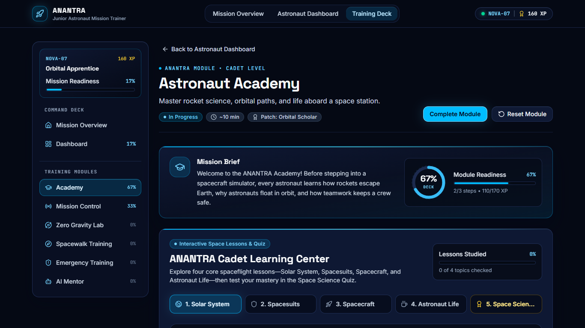
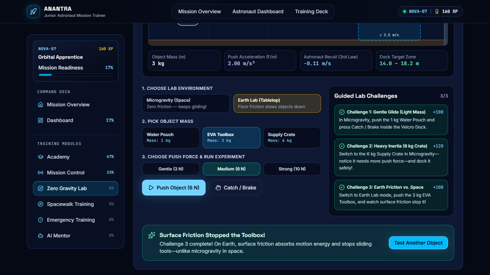
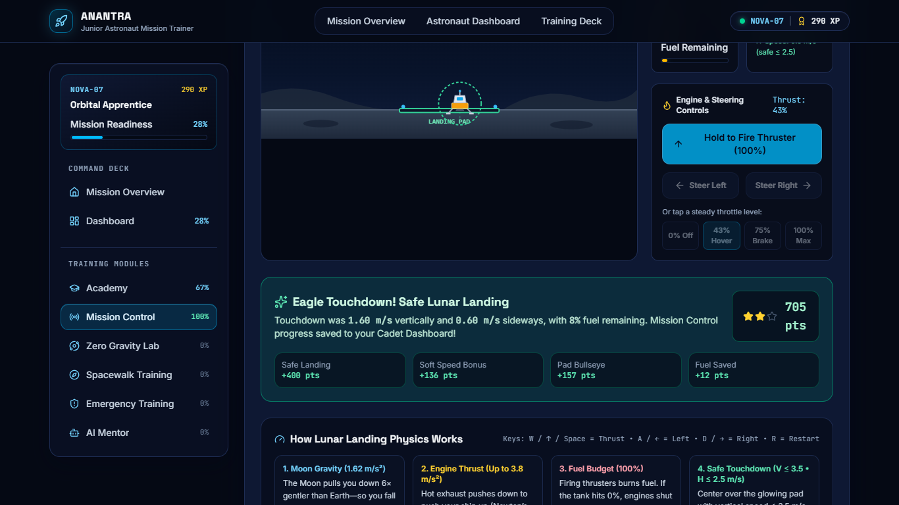
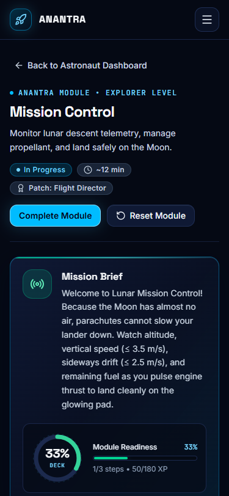
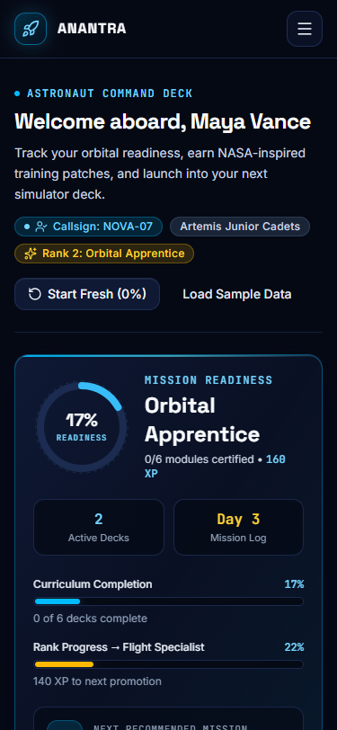

# ANANTRA — Junior Astronaut Mission Trainer: Independent Audit Report

**Audit Date:** 2026-11-10  
**Target Workspace:** `c:\Users\angad\Downloads\NASA Space App Challenge`  
**Audit Scope:** Static architecture & dependency review, automated typecheck/unit tests/production build verification, live headless Google Chrome end-to-end testing (desktop `1920×1080`, laptop `1366×768`, tablet `768×1024`, mobile `375×812` and `390×844`), `localStorage` & fault-injection testing, WCAG 2.1 AA contrast & keyboard checks, PerformanceObserver/Navigation Timing profiling, offline/air-gapped test, scientific accuracy review, and security scan (`npm audit` + static sink audit).  
**Constraint Verification:** Strict audit only — **zero project source files were modified**. Audit outputs and captured evidence reside solely in `docs/`.

---

## 1. Executive Summary

ANANTRA is a well-structured, visually cohesive React 19 + TypeScript + Vite + Tailwind CSS v4 space-training web application. Unlike many hackathon prototypes that stop at static cards, all six module sandboxes contain genuine interactive activities, `npx vitest run` passes **40/40 tests** across 8 suites, `tsc -b` and `vite build` succeed with **0 errors and 0 bundle warnings**, `npm audit` reports **0 known vulnerabilities**, and headless Chromium renders all routes across desktop, tablet, and mobile viewports with **0 console errors, 0 page errors, 0 failed online network requests, 0px horizontal overflow, 0 element overlaps, and 0 computed WCAG contrast failures**.

However, live end-to-end testing and source-level auditing uncovered **several functional disconnects, physics edge-case exploits, UI truncations, and layout shifts** that a sharp user or NASA Space Apps judge would notice in a live demo:

- **Critical Verdict on Demo Readiness:** **Conditionally demo-ready for a guided presenter demo**, **not yet polished for unguided self-serve judging**.
- **Top Structural Issue (`HIGH`):** Only 2 of 6 modules ([`AcademyPage`](file:///c:/Users/angad/Downloads/NASA%20Space%20App%20Challenge/src/features/academy/AcademyPage.tsx#L8-L27) manually via button; [`MissionControlPage`](file:///c:/Users/angad/Downloads/NASA%20Space%20App%20Challenge/src/features/mission-control/MissionControlPage.tsx#L8-L27) automatically on safe landing) record completion into [`TrainingContext`](file:///c:/Users/angad/Downloads/NASA%20Space%20App%20Challenge/src/context/TrainingContext.tsx#L42-L215). Completing **Zero Gravity Lab** (`320 pts, 3/3`), **Spacewalk Training** (`984 pts`), **Emergency Training** (`300 / 300 pts`), or **AI Astronaut Mentor** leaves Dashboard, sidebar %, XP, and badges stuck at `0%` unless the user separately clicks the chrome `Complete Module` button or checklist items.
- **Simulation & Game Logic Bugs (`MEDIUM`):** Zero Gravity Lab exhibits a wall auto-dock exploit (never pressing `Catch / Brake` passes Challenge 1), unlimited mid-flight pushes, astronaut recoil calculated in Earth mode, a curriculum mismatch (`zg-2` promises floating water sphere physics that do not exist), and a final victory-banner masking bug when Challenge 3 completes last. Academy hides certification behind the Quiz results view even after `4/4` lessons and styles a failing `< 3/5` quiz score in emerald pass colors.
- **No Git Repository & Legacy Copy Drift (`MEDIUM`):** There is no `.git` folder on disk despite multi-branch team guidelines, and Landing Page / AI Mentor copy still references `"launch countdowns"` and legacy throttle labels (`Full` / `Fine`).
- **Layout Shift & Touch Targets (`MEDIUM` / `LOW`):** Hydrating `TrainingContext` from `'loading'` to `'ready'` shifts the `<footer>` and main layout on initial load (CLS up to `0.2083` in full navigation flow; `0.0426–0.0521` on isolated route loads), and mobile/compact controls use `32px–40px` heights below the `44×44px` touch ergonomics target.

---

## 2. Project Inventory

### 2.1 Configuration, Build & Documentation Files
- [package.json](file:///c:/Users/angad/Downloads/NASA%20Space%20App%20Challenge/package.json): `anantra-junior-astronaut-trainer@0.1.0`, ESM module.
  - **Runtime Dependencies (5):** `react` (`^19.3.1`), `react-dom` (`^19.3.1`), `react-router-dom` (`^7.18.5`), `lucide-react` (`^1.71.0`), `framer-motion` (`^14.12.0`).
  - **Dev Dependencies (11):** `@tailwindcss/vite`, `@testing-library/jest-dom`, `@testing-library/react`, `@types/react`, `@types/react-dom`, `@vitejs/plugin-react`, `jsdom`, `tailwindcss`, `typescript`, `vite` (`^8.3.7`), `vitest` (`^5.1.0`). (Total dependency graph per `npm audit`: `176` packages: `15` prod, `162` dev, `65` optional, `11` peer.)
- [vite.config.ts](file:///c:/Users/angad/Downloads/NASA%20Space%20App%20Challenge/vite.config.ts): Tailwind v4 Vite plugin, React plugin, `rolldownOptions.output.codeSplitting` separating `react-vendor`, `motion-vendor`, and `icons-vendor`, plus `vitest` (`jsdom`, `./src/test/setup.ts`, `css: false`).
- [index.html](file:///c:/Users/angad/Downloads/NASA%20Space%20App%20Challenge/index.html): Inline SVG data-URI favicon, dark class (`dark`), Google Fonts links (`Inter`, `JetBrains Mono`, `Space Grotesk`), viewport meta, `#050914` theme-color.
- [README.md](file:///c:/Users/angad/Downloads/NASA%20Space%20App%20Challenge/README.md): Documents setup, npm scripts, architecture tree, and module-extension instructions accurately, with one minor omission (mentions `MissionControlPage.tsx` and `AcademyPage.tsx` style extension, whereas 4 features remain unwired to `useTraining()`, and `.git` does not exist on disk).
- **Version Control Status:** `.git` directory is **absent** (`Test-Path .git === False`).

### 2.2 Routes & Feature Modules Inventory

| Route | Page / Component | Interactive Feature Implemented | Progress Wired to `TrainingContext`? | Source File |
| :--- | :--- | :--- | :--- | :--- |
| `/` | [`LandingPage`](file:///c:/Users/angad/Downloads/NASA%20Space%20App%20Challenge/src/features/landing/LandingPage.tsx#L47-L398) | Hero CTA, "Next Recommended Mission" telemetry panel, 3-step roadmap, 6 module deck cards, rank progression showcase | Read-only (`stats`, `state`) | [LandingPage.tsx](file:///c:/Users/angad/Downloads/NASA%20Space%20App%20Challenge/src/features/landing/LandingPage.tsx) |
| `/dashboard` | [`DashboardPage`](file:///c:/Users/angad/Downloads/NASA%20Space%20App%20Challenge/src/features/dashboard/DashboardPage.tsx#L28-L463) | Profile summary, `OrbitalRing` readiness, rank/curriculum progress bars, 6-patch trophy rack, live search, 4-tab status filter, reset/sample seed actions | Read & global reset/seed | [DashboardPage.tsx](file:///c:/Users/angad/Downloads/NASA%20Space%20App%20Challenge/src/features/dashboard/DashboardPage.tsx) |
| `/academy` | [`AcademyPage`](file:///c:/Users/angad/Downloads/NASA%20Space%20App%20Challenge/src/features/academy/AcademyPage.tsx#L8-L27) + [`AcademyActivity`](file:///c:/Users/angad/Downloads/NASA%20Space%20App%20Challenge/src/features/academy/AcademyActivity.tsx) | 4 interactive tabs (`Solar System`, `Spacesuits`, `Spacecraft`, `Astronaut Life`) with explorer inspectors & quick checks + Tab 5 (`Space Science Quiz`, 5 questions) | **Manual (`Save Academy Certification`)** inside Quiz results | [AcademyActivity.tsx](file:///c:/Users/angad/Downloads/NASA%20Space%20App%20Challenge/src/features/academy/AcademyActivity.tsx), [academyLessonsData.ts](file:///c:/Users/angad/Downloads/NASA%20Space%20App%20Challenge/src/features/academy/academyLessonsData.ts) |
| `/mission-control` | [`MissionControlPage`](file:///c:/Users/angad/Downloads/NASA%20Space%20App%20Challenge/src/features/mission-control/MissionControlPage.tsx#L8-L27) + [`MoonLandingSimulator`](file:///c:/Users/angad/Downloads/NASA%20Space%20App%20Challenge/src/features/mission-control/MoonLandingSimulator.tsx#L63-L1077) | Real-time 2D SVG Lunar Lander (`requestAnimationFrame` physics engine), thrust hold & presets, RCS left/right, keyboard controls, pause/resume/restart, 4-metric star scoring | **Automatic on `landed-safe`** | [MoonLandingSimulator.tsx](file:///c:/Users/angad/Downloads/NASA%20Space%20App%20Challenge/src/features/mission-control/MoonLandingSimulator.tsx), [lunarPhysics.ts](file:///c:/Users/angad/Downloads/NASA%20Space%20App%20Challenge/src/features/mission-control/lunarPhysics.ts) |
| `/zero-gravity-lab` | [`ZeroGravityLabPage`](file:///c:/Users/angad/Downloads/NASA%20Space%20App%20Challenge/src/features/zero-gravity-lab/ZeroGravityLabPage.tsx#L5-L11) + [`ZeroGravityLabActivity`](file:///c:/Users/angad/Downloads/NASA%20Space%20App%20Challenge/src/features/zero-gravity-lab/ZeroGravityLabActivity.tsx#L72-L617) | 1D `a = F / m` motion chamber (`microgravity` vs `earth` tabletop friction), 3 mass presets, 3 forces, `Push` / `Catch / Brake`, 3 guided challenges | **No** (local React state only) | [ZeroGravityLabActivity.tsx](file:///c:/Users/angad/Downloads/NASA%20Space%20App%20Challenge/src/features/zero-gravity-lab/ZeroGravityLabActivity.tsx), [zeroGravityPhysics.ts](file:///c:/Users/angad/Downloads/NASA%20Space%20App%20Challenge/src/features/zero-gravity-lab/zeroGravityPhysics.ts) |
| `/spacewalk-training` | [`SpacewalkTrainingPage`](file:///c:/Users/angad/Downloads/NASA%20Space%20App%20Challenge/src/features/spacewalk-training/SpacewalkTrainingPage.tsx#L5-L11) + [`SpacewalkActivity`](file:///c:/Users/angad/Downloads/NASA%20Space%20App%20Challenge/src/features/spacewalk-training/SpacewalkActivity.tsx#L27-L493) | 6-item EVA kit locker (3-slot validation blocking Earth tools) + 4-stage repair mission under 100% O₂ budget + star score | **No** (local React state only) | [SpacewalkActivity.tsx](file:///c:/Users/angad/Downloads/NASA%20Space%20App%20Challenge/src/features/spacewalk-training/SpacewalkActivity.tsx), [spacewalkChallengeData.ts](file:///c:/Users/angad/Downloads/NASA%20Space%20App%20Challenge/src/features/spacewalk-training/spacewalkChallengeData.ts) |
| `/emergency-training` | [`EmergencyTrainingPage`](file:///c:/Users/angad/Downloads/NASA%20Space%20App%20Challenge/src/features/emergency-training/EmergencyTrainingPage.tsx#L5-L11) + [`EmergencyMiniChallenge`](file:///c:/Users/angad/Downloads/NASA%20Space%20App%20Challenge/src/features/emergency-training/EmergencyMiniChallenge.tsx#L18-L245) | 3-alert orbital triage drill (pressure drop, power dip, solar flare) with station safety meter (`<25%` fails) & 300-pt score | **No** (local React state only) | [EmergencyMiniChallenge.tsx](file:///c:/Users/angad/Downloads/NASA%20Space%20App%20Challenge/src/features/emergency-training/EmergencyMiniChallenge.tsx), [emergencyChallengeData.ts](file:///c:/Users/angad/Downloads/NASA%20Space%20App%20Challenge/src/features/emergency-training/emergencyChallengeData.ts) |
| `/ai-mentor` | [`AiMentorPage`](file:///c:/Users/angad/Downloads/NASA%20Space%20App%20Challenge/src/features/ai-mentor/AiMentorPage.tsx#L5-L11) + [`AstronautMentorActivity`](file:///c:/Users/angad/Downloads/NASA%20Space%20App%20Challenge/src/features/ai-mentor/AstronautMentorActivity.tsx#L68-L609) | Deterministic local keyword Q&A (`ARIA`, labeled as offline prototype), live Dashboard readiness hint builder, 5-question quiz with "Explain Deeper in Chat" | **No** (local React state only) | [AstronautMentorActivity.tsx](file:///c:/Users/angad/Downloads/NASA%20Space%20App%20Challenge/src/features/ai-mentor/AstronautMentorActivity.tsx), [mentorKnowledgeBase.ts](file:///c:/Users/angad/Downloads/NASA%20Space%20App%20Challenge/src/features/ai-mentor/mentorKnowledgeBase.ts) |
| `*` (404) | [`NotFoundPage`](file:///c:/Users/angad/Downloads/NASA%20Space%20App%20Challenge/src/features/not-found/NotFoundPage.tsx) | Unknown-route screen with navigation links to Dashboard and Landing | N/A | [NotFoundPage.tsx](file:///c:/Users/angad/Downloads/NASA%20Space%20App%20Challenge/src/features/not-found/NotFoundPage.tsx) |

### 2.3 Core Infrastructure, Shared UI & Utilities
- **App Entry & Shell:** [`App`](file:///c:/Users/angad/Downloads/NASA%20Space%20App%20Challenge/src/App.tsx#L56-L68), [`AppErrorBoundary`](file:///c:/Users/angad/Downloads/NASA%20Space%20App%20Challenge/src/components/ui/AppErrorBoundary.tsx), [`TrainingProvider`](file:///c:/Users/angad/Downloads/NASA%20Space%20App%20Challenge/src/context/TrainingContext.tsx#L42-L215), [`AppShell`](file:///c:/Users/angad/Downloads/NASA%20Space%20App%20Challenge/src/components/layout/AppShell.tsx#L24-L399), [`PageHeader`](file:///c:/Users/angad/Downloads/NASA%20Space%20App%20Challenge/src/components/layout/PageHeader.tsx), [`ModuleSandbox`](file:///c:/Users/angad/Downloads/NASA%20Space%20App%20Challenge/src/components/module-template/ModuleSandbox.tsx#L38-L320).
- **Shared UI Components (`src/components/ui/`):** [`BadgePill`](file:///c:/Users/angad/Downloads/NASA%20Space%20App%20Challenge/src/components/ui/BadgePill.tsx#L32-L75), [`Button` / `ButtonLink`](file:///c:/Users/angad/Downloads/NASA%20Space%20App%20Challenge/src/components/ui/Button.tsx#L51-L108), [`Card`](file:///c:/Users/angad/Downloads/NASA%20Space%20App%20Challenge/src/components/ui/Card.tsx), [`OrbitalRing`](file:///c:/Users/angad/Downloads/NASA%20Space%20App%20Challenge/src/components/ui/OrbitalRing.tsx#L11-L82), [`ProgressBar`](file:///c:/Users/angad/Downloads/NASA%20Space%20App%20Challenge/src/components/ui/ProgressBar.tsx), [`StarfieldBackground`](file:///c:/Users/angad/Downloads/NASA%20Space%20App%20Challenge/src/components/ui/StarfieldBackground.tsx), [`StateFeedback`](file:///c:/Users/angad/Downloads/NASA%20Space%20App%20Challenge/src/components/ui/StateFeedback.tsx).
- **Data, Progress & Persistence:** [`DESIGN_TOKENS`](file:///c:/Users/angad/Downloads/NASA%20Space%20App%20Challenge/src/data/designTokens.ts#L3-L89), [`TRAINING_MODULES`](file:///c:/Users/angad/Downloads/NASA%20Space%20App%20Challenge/src/data/modules.ts), [`traineeSeed.ts`](file:///c:/Users/angad/Downloads/NASA%20Space%20App%20Challenge/src/data/traineeSeed.ts), [`progress.ts`](file:///c:/Users/angad/Downloads/NASA%20Space%20App%20Challenge/src/utils/progress.ts), [`storage.ts`](file:///c:/Users/angad/Downloads/NASA%20Space%20App%20Challenge/src/utils/storage.ts).

### 2.4 Unused Code, Legacy Copy & Minor Dead Exports
1. **Unused Feature Barrel Re-exports:** All six `src/features/*/index.ts` barrels re-export `*Data` (e.g. [`academyData`](file:///c:/Users/angad/Downloads/NASA%20Space%20App%20Challenge/src/features/academy/index.ts#L2)), whereas [`src/data/modules.ts`](file:///c:/Users/angad/Downloads/NASA%20Space%20App%20Challenge/src/data/modules.ts) imports directly from `./*Data`, leaving the 6 barrel re-exports unused by any caller.
2. **Unused Styling Token Sub-fields:** [`DESIGN_TOKENS.motion`](file:///c:/Users/angad/Downloads/NASA%20Space%20App%20Challenge/src/data/designTokens.ts#L17-L21) and `ACCENT_STYLES[accent].badge` / `.text` ([designTokens.ts](file:///c:/Users/angad/Downloads/NASA%20Space%20App%20Challenge/src/data/designTokens.ts#L24-L81)) are defined but unconsumed (`LandingPage.tsx`, `ModuleSandbox.tsx`, and `DashboardPage.tsx` inline Framer timing / Tailwind classes instead).
3. **Un-exercised Fallback Card in `ModuleSandbox`:** Because all 6 modules now pass `children`, the empty slot fallback (`"Team Feature Workspace Ready"`, [`ModuleSandbox.tsx:153-177`](file:///c:/Users/angad/Downloads/NASA%20Space%20App%20Challenge/src/components/module-template/ModuleSandbox.tsx#L153-L177)) is never rendered in production routes (though it remains intentional template scaffolding for contributor extension).
4. **No Unused NPM Packages:** All 5 runtime dependencies (`react`, `react-dom`, `react-router-dom`, `lucide-react`, `framer-motion`) are actively imported and bundled.

---

## 3. Every Feature Tested & Empirical Coverage

All automated suites and live Playwright Chromium runs executed cleanly against the compiled `vite preview` bundle (`http://127.0.0.1:4173`), archived in `docs/audit-evidence/audit-telemetry.json` and `docs/audit-evidence/verify-remaining.json`:

1. **TypeScript, Unit/RTL Tests & Production Build:** Executed `npm.cmd run typecheck`, `npm.cmd test`, and `npm.cmd run build` — exit code `0` on all three.
2. **Landing Page (`/`):** Verified header navigation links, sample telemetry card (`Maya Vance` / `NOVA-07`), `Resume` link (`/academy`), `Open Astronaut Dashboard`, `#training-modules` smooth scroll, 6 deck cards, and footer elements (`0` `<a>` links in footer).
3. **Dashboard (`/dashboard`):** Verified sample profile metrics (`160 XP`, `0/6 modules certified`, `17%` readiness), search query `"Moon"` filtering to `Mission Control`, status filter tabs (`All`, `In Progress (2)`, `Not Started (4)`, `Completed (0)` empty state), `Start Fresh (0%)`, and `Load Sample Data`.
4. **Astronaut Academy (`/academy`):** Stepped through all 4 lesson tabs (`Solar System`, `Spacesuits`, `Spacecraft`, `Astronaut Life`), interacted with topic explorer items, tested wrong-option misconception hints (`Try Another Option!`) and right-option unlock (`Concept Unlocked!`), checked certification availability after `4/4` lessons prior to Quiz, failed the 5-question Quiz deliberately (`0 / 5`), retook for `5 / 5`, clicked `Save Academy Certification (+XP)`, and verified `Academy Deck Certified` + `3/3 steps`.
5. **Mission Control — Moon Landing Simulator (`/mission-control`):** Verified `Launch Lander`, `Pause`, `Resume Descent`, `Restart`, freefall hard crash (`19.7 m/s` vertically, `0.6 m/s` sideways), fuel depletion alert (`Fuel Tank Empty!`), two consecutive real-browser safe landings (`Eagle Touchdown! Safe Lunar Landing`, `(1 safe)` -> `(2 safe)`, score breakdown `705 pts` with 2 stars, `3/3 steps`, `Deck Certified`, `Flight Director` patch synced to Dashboard), `R` keyboard restart (`Descent Active`), and `Missed the Landing Pad` (`35.5 m` off-center with safe `1.5 m/s` V and `0.5 m/s` H speeds).
6. **Zero Gravity Lab (`/zero-gravity-lab`):** Tested bulkheads bounce (`bounced-retry`), gentle push auto-dock exploit (never clicking `Catch / Brake`), mid-flight second push (`2.40 m/s` -> `4.80 m/s`), Challenge 1 -> Challenge 2 -> Challenge 3 sequence (`320 pts (3/3 Challenges)`), final banner copy masking (`Surface Friction Stopped the Toolbox!`), `Reset Object`, and Dashboard sync check.
7. **Spacewalk Training (`/spacewalk-training`):** Tested button gating before selecting 3 tools, blocking 4th tool selection, Earth-tool rejection (`Heavy Steel Hammer` -> `-6% O₂`), repeated failures depleting O₂ to `0%` (`Oxygen Depleted — Airlock Recall`), full 4-stage repair (`984 pts`, `43% O₂`), and Dashboard sync check.
8. **Emergency Training (`/emergency-training`):** Tested disabled/safety-drop failure state (`Safety Threshold Breached — Retry Drill`), recovery retry, all 3 correct triage decisions (`300 / 300 pts`, `100%` safety, `All Alerts Stabilized! Calm Crisis Commander`), and Dashboard sync check.
9. **AI Astronaut Mentor (`/ai-mentor`):** Verified empty submit disabled, offline prototype disclosure (`role="note"`), matched query reply (`How do rockets lift off?`), unknown query fallback (`purple banana unicorn`), dynamic `Get My Readiness Hint`, `Reset Chat`, Quiz `Explain Deeper in Chat` handoff, full 5-question quiz completion (`4 / 5`), and Dashboard sync check.
10. **404, Persistence, Fault Tolerance, Responsiveness, Accessibility, Performance & Security:** Tested unknown route redirect CTA, `localStorage` reload persistence, corrupted JSON & schema-invalid JSON recovery, `QuotaExceededError` simulation, 5 viewports × 8 routes (`40` layout combinations + `16` overlap scans), `Tab` skip-link focus, `Escape` mobile drawer dismissal, WCAG AA contrast evaluation, Navigation Timing + `PerformanceObserver` CLS/FCP/LCP, and offline Google Fonts blocking.

---

## 4. Passed Tests

### 4.1 Build, TypeScript, Unit Tests & Dependency Audit (Verbatim Results)
- `npm.cmd run typecheck` (`tsc -b --pretty false`) -> **PASSED** (`Exit 0`, `0` TypeScript errors).
- `npm.cmd test` (`vitest run`) -> **PASSED** (`Exit 0`):
  - **8 test files passed, 40/40 tests passed** in `18.57s`:
    - [progress.test.ts](file:///c:/Users/angad/Downloads/NASA%20Space%20App%20Challenge/src/test/progress.test.ts): 6 tests
    - [ZeroGravityLabActivity.test.tsx](file:///c:/Users/angad/Downloads/NASA%20Space%20App%20Challenge/src/features/zero-gravity-lab/ZeroGravityLabActivity.test.tsx): 4 tests
    - [EmergencyMiniChallenge.test.tsx](file:///c:/Users/angad/Downloads/NASA%20Space%20App%20Challenge/src/features/emergency-training/EmergencyMiniChallenge.test.tsx): 2 tests
    - [SpacewalkActivity.test.tsx](file:///c:/Users/angad/Downloads/NASA%20Space%20App%20Challenge/src/features/spacewalk-training/SpacewalkActivity.test.tsx): 2 tests
    - [AstronautMentorActivity.test.tsx](file:///c:/Users/angad/Downloads/NASA%20Space%20App%20Challenge/src/features/ai-mentor/AstronautMentorActivity.test.tsx): 5 tests
    - [AcademyActivity.test.tsx](file:///c:/Users/angad/Downloads/NASA%20Space%20App%20Challenge/src/features/academy/AcademyActivity.test.tsx): 3 tests
    - [app.test.tsx](file:///c:/Users/angad/Downloads/NASA%20Space%20App%20Challenge/src/test/app.test.tsx): 7 tests (note: benign `jsdom` Framer Motion `Reduced Motion` stderr log only)
    - [MoonLandingSimulator.test.tsx](file:///c:/Users/angad/Downloads/NASA%20Space%20App%20Challenge/src/features/mission-control/MoonLandingSimulator.test.tsx): 11 tests
- `npm.cmd run build` (`tsc -b && vite build`) -> **PASSED** (`Exit 0`, `2560 modules transformed` in `1.72s`, **0 chunk-size warnings**).
- `npm.cmd audit --json` -> **PASSED** (`Exit 0`, `0` vulnerabilities across `176` dependencies).

### 4.2 Verified Live Browser Flows (Playwright + Headless Chrome)
- **Navigation, Routing & 404:** Landing CTAs, header/sidebar/drawer navigation, and `/unknown-orbital-route-404` recovery to Dashboard all passed with `0` console/page/network errors.
- **Dashboard Filtering & State Reset:** Search filtering (`"Moon"`), status filter tabs (`All (6)`, `In Progress (2)`, `Not Started (4)`, `Completed (0)` empty state), `Start Fresh (0%)` (`0 XP`), and `Load Sample Data` (`160 XP`) all passed.
- **Moon Landing Simulator Mechanics (Real Browser):** Launch, Pause/Resume, Restart button, `R` keyboard shortcut restart, hard impact crash (`19.7 m/s` V / `0.6 m/s` H), Fuel Tank Empty alert, 2 consecutive safe landings updating `(1 safe)` -> `(2 safe)`, score calculation (`705 pts`), automatic `mc-3` / `3/3` / `Flight Director` patch persistence, and `Missed the Landing Pad` (`35.5 m` off-pad) all passed.
- **`localStorage` Persistence & Fault Recovery:** Manual checklist toggle persisted across page reload (`340 XP`, `33%` synchronized between sidebar Dossier, sidebar Dashboard link, and main `OrbitalRing`); corrupted JSON (`{broken json!!!`), schema-invalid JSON, and `QuotaExceededError` write failures all rendered non-crashing recovery UI (`ErrorState`) with working Restore/Dismiss actions.
- **Responsiveness & Overlap Checks:** `0px` horizontal overflow across **40 viewport/route combinations** (`1920`, `1366`, `768`, `375`, `390` × 8 routes) and `0` bounding-box overlaps across **16 interactive overlap scans** (`1366×768` and `375×812` × 8 routes).
- **Accessibility Basics:** Skip-to-main link receives first keyboard `Tab` focus and jumps to `#main-content`; mobile drawer opens and closes via `Escape`; **0 computed WCAG AA color contrast failures** across all routes.
- **Offline App Execution:** Blocking external requests aborts only the Google Fonts stylesheet while the full SPA renders and operates cleanly with system fallback fonts.

---

## 5. Failed Tests & Confirmed Bugs

| ID | Category | Failing Expectation / Observed Bug | Evidence / Location |
| :--- | :--- | :--- | :--- |
| **BUG-01** | Cross-Module State | Completing interactive activities in Modules 3, 4, 5, and 6 (`Zero Gravity Lab`, `Spacewalk Training`, `Emergency Training`, `AI Mentor`) **never** marks checklist tasks complete or updates Dashboard progress/XP/patches (`zg/eva/emg/mentorModuleChecklistSyncedToDashboard: false`). | [`ZeroGravityLabPage.tsx:5-11`](file:///c:/Users/angad/Downloads/NASA%20Space%20App%20Challenge/src/features/zero-gravity-lab/ZeroGravityLabPage.tsx#L5-L11), [`SpacewalkTrainingPage.tsx:5-11`](file:///c:/Users/angad/Downloads/NASA%20Space%20App%20Challenge/src/features/spacewalk-training/SpacewalkTrainingPage.tsx#L5-L11), [`EmergencyTrainingPage.tsx:5-11`](file:///c:/Users/angad/Downloads/NASA%20Space%20App%20Challenge/src/features/emergency-training/EmergencyTrainingPage.tsx#L5-L11), [`AiMentorPage.tsx:5-11`](file:///c:/Users/angad/Downloads/NASA%20Space%20App%20Challenge/src/features/ai-mentor/AiMentorPage.tsx#L5-L11) |
| **BUG-02** | Physics / Game Exploits | In Zero Gravity Lab, pushing `1 kg Water Pouch` with `Gentle (3 N)` (`2.40 m/s ≤ 2.5`) and pressing **nothing** lets the pouch coast past the Velcro Dock into the bulkhead at `19.2 m`, **teleporting back to `18.2 m` as `docked-success`** (`autoDockedAtWallWithoutBrake: true`) and passing Challenge 1 without ever braking. | [`zeroGravityPhysics.ts:187-203`](file:///c:/Users/angad/Downloads/NASA%20Space%20App%20Challenge/src/features/zero-gravity-lab/zeroGravityPhysics.ts#L187-L203) |
| **BUG-03** | Simulation Controls | `Push Object` remains enabled while `gliding` or `stopped-short` (`ZeroGravityLabActivity.tsx:481-488`), allowing repeated telekinetic mid-flight velocity boosts (`2.40 m/s` -> `4.80 m/s`). Additionally, `applyPushImpulse` mutates `recoilVelocity` (`-0.11 m/s`) even in `Earth Lab` tabletop mode! | [`ZeroGravityLabActivity.tsx:481-488`](file:///c:/Users/angad/Downloads/NASA%20Space%20App%20Challenge/src/features/zero-gravity-lab/ZeroGravityLabActivity.tsx#L481-L488), [`zeroGravityPhysics.ts:87-106`](file:///c:/Users/angad/Downloads/NASA%20Space%20App%20Challenge/src/features/zero-gravity-lab/zeroGravityPhysics.ts#L87-L106) |
| **BUG-04** | Victory Banner Masking | Finishing Zero Gravity Lab in natural order (`Challenge 1 -> 2 -> 3`, where Challenge 3 ends in `Earth Lab` `stopped-short`) renders `"Surface Friction Stopped the Toolbox!"` instead of `"All Zero-G Inertia Challenges Mastered!"` (`masteryTextVisibleWhenCh3Last: false`) despite showing `320 pts (3/3 Challenges)`. | [`ZeroGravityLabActivity.tsx:566-570`](file:///c:/Users/angad/Downloads/NASA%20Space%20App%20Challenge/src/features/zero-gravity-lab/ZeroGravityLabActivity.tsx#L566-L570) & screenshot proof below |
| **BUG-05** | Certification UX Gate | Studying all `4/4` Academy lessons unlocks certification logically, yet `"Save Academy Certification (+XP)"` is **invisible on Tabs 1–4** (`certifyOnLesson4BeforeQuiz: false`) because it is rendered strictly inside Tab 5's finished quiz branch (`{!quizFinished ? ... : ...}`). | [`AcademyActivity.tsx:554`](file:///c:/Users/angad/Downloads/NASA%20Space%20App%20Challenge/src/features/academy/AcademyActivity.tsx#L554), [`AcademyActivity.tsx:693-705`](file:///c:/Users/angad/Downloads/NASA%20Space%20App%20Challenge/src/features/academy/AcademyActivity.tsx#L693-L705) |
| **BUG-06** | Fail-State Visual Contrast | Scoring `0 / 5` (or `< 3/5`) on the Academy Space Science Quiz renders the failure retry card inside an **emerald-green pass container** (`border-emerald-400/40 bg-emerald-500/10`) with green `Sparkles` (`failScoreBannerHasEmeraldClass: true`), visually mimicking success. | [`AcademyActivity.tsx:660-666`](file:///c:/Users/angad/Downloads/NASA%20Space%20App%20Challenge/src/features/academy/AcademyActivity.tsx#L660-L666) |
| **BUG-07** | Laptop Viewport UI Clip | At `1366×768` desktop resolution, Tab 5 `"5. Space Science Quiz"` in [`AcademyActivity`](file:///c:/Users/angad/Downloads/NASA%20Space%20App%20Challenge/src/features/academy/AcademyActivity.tsx#L419) truncates mid-word to `"5. Space Scien..."` inside the `sm:grid-cols-5` grid alongside the fixed sidebar. | [`AcademyActivity.tsx:419`](file:///c:/Users/angad/Downloads/NASA%20Space%20App%20Challenge/src/features/academy/AcademyActivity.tsx#L419) & `desktop-1366-academy.png` |
| **BUG-08** | Curriculum Mismatch | Zero Gravity checklist step `zg-2` (`"Observe Water Sphere Physics — Examine why water sticks to surfaces and forms spheres"`) has no water-droplet or surface-tension experiment; `water-pouch` is just a `1 kg` sliding block in a 1D track. | [`zeroGravityData.ts:40-44`](file:///c:/Users/angad/Downloads/NASA%20Space%20App%20Challenge/src/features/zero-gravity-lab/zeroGravityData.ts#L40-L44) |
| **BUG-09** | Marketing / Mentor Copy Drift | Landing page copy references `"launch countdowns"` and `"command launch control"` instead of the actual lunar landing descent simulator, and Mentor knowledge base references obsolete throttle labels (`"pulse Full or Fine thrust in the final 100 meters"`) instead of current `0% / 43% Hover / 75% Brake / 100% Max` controls at `120 m`. | [`LandingPage.tsx:36`](file:///c:/Users/angad/Downloads/NASA%20Space%20App%20Challenge/src/features/landing/LandingPage.tsx#L36), [`LandingPage.tsx:87`](file:///c:/Users/angad/Downloads/NASA%20Space%20App%20Challenge/src/features/landing/LandingPage.tsx#L87), [`mentorKnowledgeBase.ts:191`](file:///c:/Users/angad/Downloads/NASA%20Space%20App%20Challenge/src/features/ai-mentor/mentorKnowledgeBase.ts#L191) |

*(Note on Run 1 vs Verification Run: In Run 1 of `audit-telemetry.json`, Playwright's initial naive autopilot failed to land safely because its loop hovered/oscillated at 45m; once corrected in `verify-remaining.json` to follow a true braking curve, `MoonLandingSimulator` passed **all** real-browser safe landings, `(2 safe)`, crash, fuel empty, and missed-pad checks. Thus `MoonLandingSimulator`'s core physics & HUD are confirmed working; the earlier failure belonged to the first Playwright autopilot heuristic.)*

---

## 6. Partially Working Features

1. **Checklist & Progression Synchronization:** Works end-to-end inside `MissionControlPage` (automatic) and `AcademyPage` (via Quiz-screen button), plus manual task clicks on all 6 module side-checklists (`ModuleSandbox`). **Disconnects** after finishing Zero Gravity, Spacewalk, Emergency, and Mentor activities unless users scroll down and click checklist rows manually.
2. **Spacewalk EVA Workflow:** 6-tool locker validation (`3` certified tools required) and `4`-stage O₂ challenge work smoothly, **but Stage 4** ([`spacewalkChallengeData.ts:158-183`](file:///c:/Users/angad/Downloads/NASA%20Space%20App%20Challenge/src/features/spacewalk-training/spacewalkChallengeData.ts#L158-L183)) only asks a multiple-choice hatch-return question and does not actually carry over or inspect the 3-tool inventory packed in Phase 1. Also, `3/3` repair tools work cleanly in stages 1–3 only because the script/UI presents the three certified names as stage buttons rather than dynamically gating against your packed kit.
3. **Academy Certification Progression:** Studying lessons `1–4` tracks `1..4 of 4` topics properly, yet completing `4/4` never offers certification without opening Tab 5 (`Space Science Quiz`) and answering all 5 questions (even to a `0/5` fail!).
4. **Zero Gravity Lab (`Earth` vs `Microgravity`):** Mode switching changes deceleration cleanly, **yet** astronaut recoil still fires in Earth tabletop mode, pushing mid-flight is permitted, and Challenge 3 completion hides Challenge Mastery text.
5. **Module XP Reward Display on Dashboard:** Cards in `not-started` or `in-progress` status display `Reward: +totalPossibleXp XP` (e.g., `+170 XP` on Academy even when `110/170 XP` has already been earned and only `+60 XP` remains — [`DashboardPage.tsx:430-434`](file:///c:/Users/angad/Downloads/NASA%20Space%20App%20Challenge/src/features/dashboard/DashboardPage.tsx#L430-L434)).

---

## 7. Unfinished or Incomplete Features

1. **Editable Trainee Profile / Multi-Cadet Switcher:** Profile (`Maya Vance`, `NOVA-07`, `Artemis Junior Cadets`) is hardcoded in [`traineeSeed.ts`](file:///c:/Users/angad/Downloads/NASA%20Space%20App%20Challenge/src/data/traineeSeed.ts#L3-L61); a child cannot enter their own name or switch student profiles in a classroom setting.
2. **In-Sim High-Score / Attempt Persistence:** `bestScore`, `safeLandingsCount`, Zero Gravity challenge progress/320 pts, Spacewalk score/984 pts, and Emergency score live in ephemeral React `useState` and vanish on refresh or route navigation (only `completedTaskIds` persist in `localStorage`).
3. **Water Sphere Microgravity Experiment (`zg-2`):** Described in `zeroGravityData.ts` (`missionBrief`, `funFacts`, `zg-2`) but absent from `ZeroGravityLabActivity`.
4. **Footer Utility / Attribution Links:** `<footer>` renders static status text only (`0` links; no NASA source attribution view, credits, or keyboard shortcuts help link).
5. **Visual Audio/Sound Toggle & Mobile D-Pad Ergonomics:** Purely silent visual simulations; on Moon Landing Simulator, simultaneous `Hold to Fire Thruster` + `Steer Left/Right` multi-touch on phone requires awkward thumb placement across stacked controls.

---

## 8. UI / UX Issues (With Screenshot Evidence)

### 8.1 Academy Tab Truncation at `1366×768` (`MEDIUM`)
At standard laptop width (`1366×768`) with the desktop sidebar (`w-68`) open, the 5-column tab strip inside `ANANTRA Cadet Learning Center` clips the fifth tab to **`5. Space Scien...`**:

### 8.2 Zero Gravity Lab Victory Banner Masking & Earth-Mode Recoil (`MEDIUM`)
With `Guided Lab Challenges` displaying `3/3` green checkmarks (`320 pts`), finishing Challenge 3 (`Earth Lab`) last displays `"Surface Friction Stopped the Toolbox!"` rather than overall challenge mastery; simultaneously, the `Astronaut Recoil (3rd Law)` metric still reads `-0.11 m/s` in Earth tabletop mode, and the sidebar remains stuck at `Zero Gravity Lab 0%` / `160 XP`:

### 8.3 Moon Landing Simulator Touchdown State & Vertical Placement (`LOW`)
Once landed cleanly (`Eagle Touchdown!`, `705 pts`, `2 stars`, sidebar synced to `Mission Control 100%` / `290 XP`), the SVG HUD is crisp. Two minor visual notes:
1. Inside the SVG at touchdown (`desktop-1366-moon-lander-safe.png`), the green dashed `r=34` touchdown highlight circle clips slightly across the top of the `LANDING PAD` monospace label.
2. On both desktop (`1366×768`) and mobile (`375×812`, `mobile-375-mission-control.png`), placing `PageHeader` + `Mission Brief` card *above* `<section aria-label="Interactive activity">` pushes the interactive simulator canvas below the initial fold so kids must scroll down on every module visit before playing.

### 8.4 Mobile Dashboard Minor Polish & Sub-44px Touch Targets (`LOW`)
Mobile layout at `375×812` has `0px` horizontal overflow and high contrast, but exhibits minor visual blemishes:
- `"0/6 modules certified • 160 XP"` wraps `"XP"` onto an orphan line (`mobile-375-dashboard.png`).
- `Callsign: NOVA-07` `BadgePill` enables both `dot` and `icon`, rendering a cyan dot next to an outline person icon inside a compact pill.
- Several mobile interactive controls are `< 44px` tall: mobile hamburger button (`40×40px`), AI Mentor topic chips (`32px`), `Button size="sm"` (`36px` tall), throttle presets (`36px`), `Steer Left/Right` (`40px`). While passing WCAG 2.2 AA `24×24px` target size, this falls short of the `44×44px` iOS/Android child-touch ergonomics target.

---

## 9. Security Issues

1. **Dependency & Vulnerability Check:** `npm.cmd audit --json` found **0 vulnerabilities** (`info: 0`, `low: 0`, `moderate: 0`, `high: 0`, `critical: 0`) across `176` dependencies.
2. **Code Injection / Secret Hygiene:** Static scan across all files under `src/` found **0** occurrences of `dangerouslySetInnerHTML`, `innerHTML`, `eval`, `new Function`, `document.write`, `import.meta.env`, `process.env`, API keys, tokens, `fetch`, `XMLHttpRequest`, or `WebSocket`. No external `<a target="_blank">` links exist anywhere in `src/`.
3. **Low-Severity Security / Robustness Findings (`LOW`):**
   - **External Google Fonts Supply Chain & Offline/Privacy Exposure ([`index.html:16-21`](file:///c:/Users/angad/Downloads/NASA%20Space%20App%20Challenge/index.html#L16-L21)):** Requests CSS and font binaries from `fonts.googleapis.com` and `fonts.gstatic.com` without `rel`/`integrity` constraints or self-hosting, leaking user IP/User-Agent to third-party font CDNs and causing fallback fonts in air-gapped classrooms.
   - **No CSP / Security Headers in Static Entry ([`index.html`](file:///c:/Users/angad/Downloads/NASA%20Space%20App%20Challenge/index.html)):** Static HTML lacks a Content Security Policy meta tag or deployment header guidance.
   - **`localStorage` Schema Type Check Lacks String-Length / Item Bounds ([`storage.ts:22-48`](file:///c:/Users/angad/Downloads/NASA%20Space%20App%20Challenge/src/utils/storage.ts#L22-L48)):** [`isValidTrainingState`](file:///c:/Users/angad/Downloads/NASA%20Space%20App%20Challenge/src/utils/storage.ts#L22-L48) validates types thoroughly against arbitrary JSON corruption (`profile.name`, `version`, array strings), though an artificially huge `profile.name` manually injected into `localStorage` is rendered untruncated on `/dashboard` (safe from XSS thanks to React JSX escaping, only cosmetic layout stretch).

---

## 10. Scientific Accuracy Audit

### 10.1 Verified Scientifically Accurate Content
- **Lunar Physics & Spaceflight Facts:** Moon surface gravity (`1.62 m/s²`, ~1/6 Earth), airless vacuum preventing parachutes on the Moon, Earth surface gravity (`9.81 m/s²`), Mars thin CO₂ atmosphere (~100× thinner, `3.72 m/s²`, 24h 39m sol), Earth-Moon distance (`384,400 km`), ISS orbital speed (~`28,000 km/h`), ~`90 min` orbital period (`16` sunrises/sunsets/day), ~`400 km` altitude, continuous free fall (~`90%` Earth gravity still present in LEO), rocket staging dropping dead mass (`a = F/m`), blunt-body heat shields pushing shockwaves off hulls (`1,600°C+` plasma).
- **Spacesuit & Crew Health Facts:** Pure-O₂ low suit pressure (~`29.6 kPa` / `4.3 psi`) balancing mobility and blood-gas safety, `-157°C` to `+121°C` thermal extremes, razor-thin gold visor coating reflecting UV/IR solar glare, ~`91 m` (`300 ft`) LCVG water-cooling garment compensating for vacuum's lack of evaporative/convective cooling, ~`127 kg` Earth mass, wall-tethered sleeping bags near air fans preventing CO₂ pockets, tortillas avoiding hazardous floating bread crumbs, ~`2 hr`/day resistive & bungee exercise against bone/muscle loss, ECLSS ~`98%` water recovery, and high-hydrogen water-wall radiation storm shielding.

### 10.2 Simplified Game Physics & Inaccuracies Found (`MEDIUM` / `LOW`)

| Area | Current Model Behavior | Scientific Deviation / Clarification | Severity |
| :--- | :--- | :--- | :--- |
| Zero-G Earth Recoil | [`applyPushImpulse`](file:///c:/Users/angad/Downloads/NASA%20Space%20App%20Challenge/src/features/zero-gravity-lab/zeroGravityPhysics.ts#L87-L106) decrements `recoilVelocity` (`-0.11 m/s`) even in **Earth Lab (Tabletop)** mode (`desktop-1366-zero-g-lab.png`). | On Earth, static friction between shoes and the floor keeps the experimenter anchored; showing `-0.11 m/s` recoil in Earth mode contradicts its own lesson comparing space reaction vs Earth friction. | `MEDIUM` |
| Zero-G Wall Teleport | Pushing gently (`≤ 2.5 m/s`) lets objects collide with `19.2 m` metal bulkhead and snap backward to `18.2 m` as `"Safely Anchored in the Velcro Dock"`. | Real microgravity objects at `2.4 m/s` hitting a metal bulkhead bounce off—they do not teleport backward into a Velcro strip without catching/braking. | `MEDIUM` |
| Zero-G Curriculum Gap | Task `zg-2` teaches water sphere surface tension (`"Observe Water Sphere Physics"`). | No fluid droplet or cohesion/adhesion experiment is implemented—all 3 items follow rigid 1D sliding kinematics. | `MEDIUM` |
| Lunar Descent Simplifications | Fixed mass (`MAX_THRUST_ACCEL = 3.8` constant regardless of burned fuel); no pitch rotation for horizontal thrust; vertical safe limit `3.5 m/s` (~`11.5 ft/s`), horizontal `2.5 m/s`. | Acceptable kid-friendly point-mass simplification. Apollo LM gear limit was ~`3.05 m/s` (`10 ft/s`), targeting `0.5–1.0 m/s` (which [`mentorKnowledgeBase.ts:191`](file:///c:/Users/angad/Downloads/NASA%20Space%20App%20Challenge/src/features/ai-mentor/mentorKnowledgeBase.ts#L191) accurately clarifies). Hover throttle `Math.round(1.62/3.8*100) = 43%` yields tiny upward climb (`+0.014 m/s²`) rather than true neutral `42.6%`. | `LOW` |
| Spacewalk PLSS Consumption | Discrete percentage O₂ deductions per multiple-choice action (`12–22% O₂`) with no baseline metabolic/suit-leak rate over time. | Clean educational abstraction of oxygen budgeting for kids, though real PLSS consumption is time- and workload-rate driven. | `LOW` |

---

## 11. Performance Findings

### 11.1 Production Bundle Sizes (`vite build` + `dist/`)
Total bundle splits cleanly via Rolldown into cached vendor chunks with **zero build warnings**:
- `dist/index.html`: `1.92 kB` (`gzip: 0.89 kB`)
- `dist/assets/index-*.css`: `86.71 kB` (`gzip: 12.24 kB`)
- `dist/assets/rolldown-runtime-*.js`: `0.59 kB` (`gzip: 0.36 kB`)
- `dist/assets/icons-vendor-*.js`: `14.90 kB` (`gzip: 5.62 kB`)
- `dist/assets/motion-vendor-*.js`: `135.42 kB` (`gzip: 45.29 kB`)
- `dist/assets/index-*.js`: `205.81 kB` (`gzip: 54.58 kB`)
- `dist/assets/react-vendor-*.js`: `256.32 kB` (`gzip: 81.28 kB`)
- **Total raw JS+CSS+HTML payload:** ~`701.7 kB` (~`200.3 kB` gzipped), excluding external Google Fonts (~`50–150 kB` over network when online).
- Route-level code splitting (`React.lazy`) is not enabled—`App.tsx` eagerly imports all 6 pages (`index-*.js` is `205.81 kB`), which loads fast locally (`54.58 kB` gzip) and avoids route-switch spinners, at a small initial parse cost.

### 11.2 Headless Chromium Performance Telemetry
*(Method: Chrome PerformanceNavigationTiming & PerformanceObserver `paint`/`largest-contentful-paint`/`layout-shift` against local `vite preview`; `lighthouse` CLI is not installed in this environment, so Core Web Vitals were measured directly via Chromium observers rather than synthetic Lighthouse throttling.)*

| Metric | `/` (Landing, Cold) | `/dashboard` | `/mission-control` | `/academy` |
| :--- | :---: | :---: | :---: | :---: |
| **DOMContentLoaded** | `796 ms` | `83 ms` | `77 ms` | `60 ms` |
| **Load** | `798 ms` | `83 ms` | `77 ms` | `60 ms` |
| **FCP** | `944 ms` | `136 ms` | `156 ms` | `132 ms` |
| **LCP** | `1308 ms` | `188 ms` | `188 ms` | `200 ms` |
| **CLS (Full E2E Flow)** | `0.0017` | `0.0853` | **`0.1563`** ⚠️ | **`0.2083`** ⚠️ |
| **CLS (Isolated Fresh Load)** | — | `0.0426` | `0.0521` | `0` |
| **DOM Node Count** | `479` | `570` | `473` | `427` |
| **JS Heap Used** | `3.41 MB` | `4.82 MB` | `6.54 MB` | `8.84 MB` |

- **Root Cause of CLS:** In isolated loads (`verify-remaining.json`), `PerformanceObserver` directly attributed the `0.0426` (`/dashboard` at `75ms`) and `0.0521` (`/mission-control` at `223ms`) shifts to **`FOOTER` (`prevY: 727.75px` -> pushed off-viewport)**! This occurs because [`TrainingContext.tsx:43`](file:///c:/Users/angad/Downloads/NASA%20Space%20App%20Challenge/src/context/TrainingContext.tsx#L43) initializes `status` to `'loading'`, causing [`AppShell.tsx:380`](file:///c:/Users/angad/Downloads/NASA%20Space%20App%20Challenge/src/components/layout/AppShell.tsx#L380) to paint `<LoadingState />` above the footer before immediately flipping to `'ready'` inside `useEffect`. In multi-route cold visits, font loading (`Space Grotesk`/`Inter`) plus dynamic content expansion raised observed CLS up to `0.2083` on `/academy` (exceeding Google's `≤ 0.1` Good threshold).

---

## 12. Visual Proof & Reproduction Steps

- All raw Playwright JSON logs and screenshots are archived inside `docs/audit-evidence/`:
  - `docs/audit-evidence/audit-telemetry.json`
  - `docs/audit-evidence/verify-remaining.json`
  - `docs/audit-evidence/desktop-1366-academy.png`
  - `docs/audit-evidence/desktop-1366-moon-lander-safe.png`
  - `docs/audit-evidence/desktop-1366-zero-g-lab.png`
  - `docs/audit-evidence/mobile-375-dashboard.png`
  - `docs/audit-evidence/mobile-375-mission-control.png`

---

## 13. Exact Reproduction Steps for Every Bug Found

1. **BUG-01 (Cross-Module Progress Disconnect):**
   1. Navigate to `/spacewalk-training` (or `/zero-gravity-lab`, `/emergency-training`, `/ai-mentor`).
   2. Complete the entire interactive simulation (`984 pts` in Spacewalk / `3/3 Challenges` in Zero-G / `300/300 pts` in Emergency / `5/5` quiz in AI Mentor).
   3. **Observed:** Both the module's own `Module Readiness` ring and `/dashboard` remain at `0%` (`0/3 steps`); sidebar and `Dashboard` patch rack stay locked.
2. **BUG-02 (Zero-G Wall Auto-Dock Exploit):**
   1. Open `/zero-gravity-lab` in `Microgravity (Space)` mode with `1 kg Water Pouch` and `Gentle (3 N)`.
   2. Click `Push Object (3 N)` once and touch **no** other controls for ~`8` seconds.
   3. **Observed:** Pouch slides past `14.0–18.2 m` at `2.40 m/s`, hits `19.2 m`, snaps back to `18.2 m`, awards `+100 pts` Challenge 1 (`docked-success`), and praises catching with counter-force despite never touching `Catch / Brake`.
3. **BUG-03 (Mid-Flight Telekinetic Push + Earth Recoil):**
   1. Open `/zero-gravity-lab`, select `Earth Lab (Tabletop)`, `3 kg EVA Toolbox`, `Medium (6 N)`.
   2. Click `Push Object (6 N)` (`Astronaut Recoil (3rd Law)` shows `-0.11 m/s`). Click `Push Object` a second time mid-slide.
   3. **Observed:** Object accelerates mid-slide (`2.40 -> 4.80 m/s` on Water Pouch in Zero-G test) and Earth mode displays non-zero astronaut recoil.
4. **BUG-04 (Masked Zero-G Victory Banner):**
   1. On `/zero-gravity-lab`, complete Challenge 1 (`Water Pouch` in Microgravity), then Challenge 2 (`Supply Crate` in Microgravity), then Challenge 3 (`EVA Toolbox` in Earth Lab).
   2. **Observed:** Counter reads `320 pts (3/3 Challenges)` and all 3 challenge cards turn green, yet the feedback banner heading renders `"Surface Friction Stopped the Toolbox!"` instead of `"All Zero-G Inertia Challenges Mastered!"`.
5. **BUG-05 & BUG-06 (Academy Certification Hidden & Emerald Fail Styling):**
   1. Open `/academy`. Study and mark all `4/4` lesson topics checked (`Solar System`..`Astronaut Life`) — stay on Tab 4.
   2. **Observed:** `"Save Academy Certification (+XP)"` does not appear on any lesson tab (`4/4` complete).
   3. Click Tab 5 (`Space Science Quiz`) and intentionally select wrong answers for all 5 questions (`0 / 5`).
   4. **Observed:** Retry banner renders inside green emerald classes (`border-emerald-400/40 bg-emerald-500/10`) with green `Sparkles`.
6. **BUG-07 (Laptop Tab Clipping):**
   1. Open `/academy` in a `1366×768` viewport with desktop sidebar visible.
   2. **Observed:** The 5th tab label truncates to `5. Space Scien...`.
7. **BUG-08 & BUG-09 (Curriculum & Copy Mismatches):**
   1. Open `/zero-gravity-lab`, inspect task `zg-2` (`Observe Water Sphere Physics`), and compare against interactive track controls (no water droplet/sphere simulation exists).
   2. Open `/`, inspect Pillar 2 & Hero copy (`"launch countdowns"` / `"launch control"` vs lunar descent), and ask ARIA `"How do I land safely in the Moon Landing simulator?"` -> reads obsolete `"pulse Full or Fine thrust in the final 100 meters"`.
8. **CLS Layout Shift on Command Deck Navigation:**
   1. Load `/mission-control` or `/academy` cleanly with PerformanceObserver `layout-shift` tracking enabled.
   2. **Observed:** Initial `<LoadingState />` -> `'ready'` mount swap shifts `<footer>` off-screen (`0.0426–0.0521` isolated; up to `0.2083` with navigation/font shifts).

---

## 14. Severity Classification

| Severity | Count | Findings |
| :--- | :---: | :--- |
| **`CRITICAL`** | **0** | No crashes, unhandled exceptions, security exploits, or dead/broken navigation routes found. |
| **`HIGH`** | **1** | **BUG-01:** 4 of 6 interactive training activities (`Zero Gravity Lab`, `Spacewalk Training`, `Emergency Training`, `AI Mentor`) never sync completion/XP/patches to `TrainingContext` or Dashboard. |
| **`MEDIUM`** | **9** | **BUG-02** (Zero-G wall auto-dock exploit), **BUG-03** (mid-flight telekinetic push & Earth recoil), **BUG-04** (Ch3 masks mastery banner), **BUG-05** (Academy lesson-only certification hidden behind Quiz tab), **BUG-06** (Academy Quiz `< 3/5` failure rendered in emerald success box), **BUG-07** (`1366px` tab truncation `5. Space Scien...`), **BUG-08** (`zg-2` Water Sphere mismatch), **BUG-09** (Landing/Mentor copy mismatch), **CLS > 0.1** (`LoadingState` -> ready shift pushing `<footer>`). |
| **`LOW`** | **6** | Missing `.git` repository; hardcoded non-editable single cadet profile & non-persisted high scores; Spacewalk Stage 4 disconnected from prep kit; sub-44px mobile touch heights (`32–40px`); `Reward: +XP` card label not showing remaining XP when in-progress; unused barrel/token exports & external Google Fonts offline fallback. |

---

## 15. Prioritized Recommendations

1. **Priority 1 (`HIGH`):** Wire `useTraining().toggleTask` / `completeModule` callbacks into [`ZeroGravityLabPage`](file:///c:/Users/angad/Downloads/NASA%20Space%20App%20Challenge/src/features/zero-gravity-lab/ZeroGravityLabPage.tsx), [`SpacewalkTrainingPage`](file:///c:/Users/angad/Downloads/NASA%20Space%20App%20Challenge/src/features/spacewalk-training/SpacewalkTrainingPage.tsx), [`EmergencyTrainingPage`](file:///c:/Users/angad/Downloads/NASA%20Space%20App%20Challenge/src/features/emergency-training/EmergencyTrainingPage.tsx), and [`AiMentorPage`](file:///c:/Users/angad/Downloads/NASA%20Space%20App%20Challenge/src/features/ai-mentor/AiMentorPage.tsx) so completing challenges genuinely unlocks module tasks, XP, ranks, and patches automatically.
2. **Priority 2 (`MEDIUM`):** Fix [`zeroGravityPhysics.ts`](file:///c:/Users/angad/Downloads/NASA%20Space%20App%20Challenge/src/features/zero-gravity-lab/zeroGravityPhysics.ts) and [`ZeroGravityLabActivity.tsx`](file:///c:/Users/angad/Downloads/NASA%20Space%20App%20Challenge/src/features/zero-gravity-lab/ZeroGravityLabActivity.tsx):
   - Always bounce at `WALL_X_M` regardless of speed (no free auto-dock without pressing `Catch / Brake`).
   - Disable `Push Object` while `motion.outcome === 'gliding'`, skip `recoilVelocity` when `mode === 'earth'`, check `allChallengesDone` before `motion.outcome === 'stopped-short'` in the victory banner, and align task `zg-2` (or add a surface-tension droplet toggle).
3. **Priority 3 (`MEDIUM`):** Fix [`AcademyActivity.tsx`](file:///c:/Users/angad/Downloads/NASA%20Space%20App%20Challenge/src/features/academy/AcademyActivity.tsx):
   - Move/surface `"Save Academy Certification (+XP)"` whenever `completedLessonIds.length === 4 || quizPassed` across all tabs.
   - Style `< 3/5` quiz results with amber warning classes instead of emerald green.
   - Use responsive `flex-wrap` or shorter tab labels (`sm:grid-cols-5` -> `flex-wrap` / `"5. Mastery Quiz"`) so `1366×768` never truncates.
4. **Priority 4 (`MEDIUM`):** Eliminate first-paint `LoadingState` CLS by hydrating `localStorage` synchronously inside `useState(() => loadTrainingState())` in [`TrainingContext.tsx`](file:///c:/Users/angad/Downloads/NASA%20Space%20App%20Challenge/src/context/TrainingContext.tsx), and align [`LandingPage.tsx`](file:///c:/Users/angad/Downloads/NASA%20Space%20App%20Challenge/src/features/landing/LandingPage.tsx) & [`mentorKnowledgeBase.ts`](file:///c:/Users/angad/Downloads/NASA%20Space%20App%20Challenge/src/features/ai-mentor/mentorKnowledgeBase.ts) copy to current Lunar Descent controls.
5. **Priority 5 (`LOW`):** Initialize `.git`, add simple cadet name/callsign customization, persist best simulator scores, lift interactive touch targets (`Button size="sm"`, chips, hamburger) to `min-h-11` (`44px`), and consider self-hosting fonts for offline classrooms.

---

## 16. Independent Audit Scorecard (`/10`)

| Dimension | Score | Evidence-Based Rationale |
| :--- | :---: | :--- |
| **1. Functionality** | **7.5 / 10** | All 8 routes, filters, storage recovery, and 6 module activities run with 0 console/runtime errors, docked only because Modules 3–6 fail to update Dashboard progress automatically. |
| **2. UI / UX** | **8.0 / 10** | Cohesive NASA-inspired aesthetic, clear feedback banners, good dark-mode visual hierarchy; docked for `1366px` tab clipping, green quiz-fail card, hidden Academy certification button on Tabs 1–4, and module brief pushing sims down the fold. |
| **3. Educational Value** | **8.5 / 10** | Misconception-specific wrong-answer hints across Academy, Mentor Quiz, Spacewalk, and Emergency triage actively teach kids *why* an answer is wrong rather than merely marking X. |
| **4. Scientific Accuracy** | **8.0 / 10** | Accurate orbital physics constants (`1.62 m/s²`, `28,000 km/h`, `~90 min`, `~29.6 kPa`, `-157°C..+121°C`, LCVG `91 m`, ECLSS `98%`) with honest simplifications; docked for Zero-G Earth recoil, wall teleport, and missing water-sphere lab (`zg-2`). |
| **5. Simulation Quality** | **7.5 / 10** | `MoonLandingSimulator` delivers genuinely fun, skill-based real-time 2D physics with dual input modes; Zero-G and Spacewalk simulations are shallower with physics edge-case exploits in Zero-G. |
| **6. Responsiveness** | **8.5 / 10** | Zero horizontal overflow and zero element overlap verified across `1920`, `1366`, `768`, `375`, and `390` viewports; minor touch-target size (`32–40px`) and widow text wrapping notes. |
| **7. Accessibility** | **8.0 / 10** | 0 WCAG AA contrast violations across 8 routes, working skip-to-content link, `Escape`-dismissible mobile menu, `role="status"`/`aria-live="polite"`, semantic buttons/ARIA labels; minor sub-44px mobile touch heights. |
| **8. Security** | **9.0 / 10** | Offline zero-backend architecture, `0` `npm audit` vulnerabilities, `0` unsafe DOM/eval sinks or secrets, robust corrupted-JSON validation; minus 1 point for external Google Fonts dependency and absent CSP. |
| **9. Performance** | **7.5 / 10** | Fast `1.72s` Vite build, zero chunk warnings, sub-`200ms` LCP on command routes, tiny ~`3–9 MB` JS heap; docked for CLS (`0.04–0.21`) from initial `LoadingState` mount flash shifting the footer. |
| **10. Overall Competition Readiness** | **7.8 / 10** | Impressively complete multi-module Space Apps web prototype with real verified unit tests and zero broken routes; fixing Dashboard auto-sync across Modules 3–6 and Zero-G edge bugs would elevate it into the `9/10` range. |

---

## 17. Direct Answers to Concluding Questions

1. **Does every button and route work?**  
   **Yes for navigation and controls; partially for downstream progress side-effects.** Every visible link, nav route, 404 screen, filter, reset/seed button, simulator control, quiz option, and Q&A chip executes without dead buttons or runtime exceptions (`0` console/page errors). However, in-activity completion buttons/states inside Zero Gravity Lab, Spacewalk Training, Emergency Training, and AI Mentor only mutate local component state and do not sync `TrainingContext` tasks without clicking the shared chrome `Complete Module` button or checklist items.
2. **Are there fake or misleading features?**  
   **One minor mismatch, otherwise transparent.** ARIA explicitly discloses in [`role="note"`](file:///c:/Users/angad/Downloads/NASA%20Space%20App%20Challenge/src/features/ai-mentor/AstronautMentorActivity.tsx#L219-L238) that it is an *offline deterministic prototype, not a live AI model*—honest and non-deceptive. The only misleading element is Zero Gravity checklist task `zg-2` (`"Observe Water Sphere Physics"`) where only a sliding solid `1 kg Water Pouch` exists, plus Landing Page copy mentioning `"launch countdowns"` where Lunar Descent resides.
3. **Can a child actually use every activity from start to finish?**  
   **Yes.** A child can read all 4 Academy lessons and pass/fail/retake the quiz, launch and land on the Moon using buttons or keyboard keys (`W`/`Space`/`Arrows`/`R`), complete all 3 Zero Gravity challenges, outfit an EVA belt and repair solar arrays in Spacewalk Training, solve all 3 Emergency alerts, and chat/quiz with ARIA. The main usability speedbump for a child is not realizing why their Dashboard XP stayed unchanged after finishing Modules 3–6.
4. **Would a NASA Space Apps judge find broken logic?**  
   **Potentially yes, if testing thoroughly.** A technical judge inspecting Dashboard telemetry right after beating Spacewalk or Zero Gravity Lab would notice `0%` Dashboard completion (`BUG-01`). Pushing the Light Water Pouch once and never braking yet earning Challenge 1 mastery via wall snap-back (`BUG-02`), or seeing `Earth Lab` report `-0.11 m/s` astronaut recoil (`BUG-03`), would also catch a judge's eye.
5. **What would fail in a live demo?**  
   - Completing Spacewalk, Emergency, or Zero Gravity Lab on stage and switching to Dashboard expecting a newly unlocked patch or rank promotion (`BUG-01`).
   - Demonstrating Academy lesson mastery (`4/4`) without opening the Quiz tab and looking for the certification button (`BUG-05`), or failing the Quiz to show the retry state and seeing a green pass card (`BUG-06`).
   - Showing Academy on a `1366×768` laptop screen (`5. Space Scien...` truncated tab, `BUG-07`) or completing Zero Gravity Lab in Challenge `1 -> 2 -> 3` order and seeing `"Surface Friction Stopped the Toolbox!"` instead of overall mastery (`BUG-04`).
6. **Is the app genuinely demo-ready?**  
   **Yes for a scripted live pitch highlighting Landing -> Dashboard -> Moon Landing Simulator -> Academy -> Spacewalk/Emergency/Mentor individually; NO if expecting judges to click freely through all 6 modules and track holistic Cadet progression automatically.** Resolving `BUG-01` through `BUG-07` (~`2–4 hours` of targeted fixes) will make it genuinely competition-ready end-to-end.
